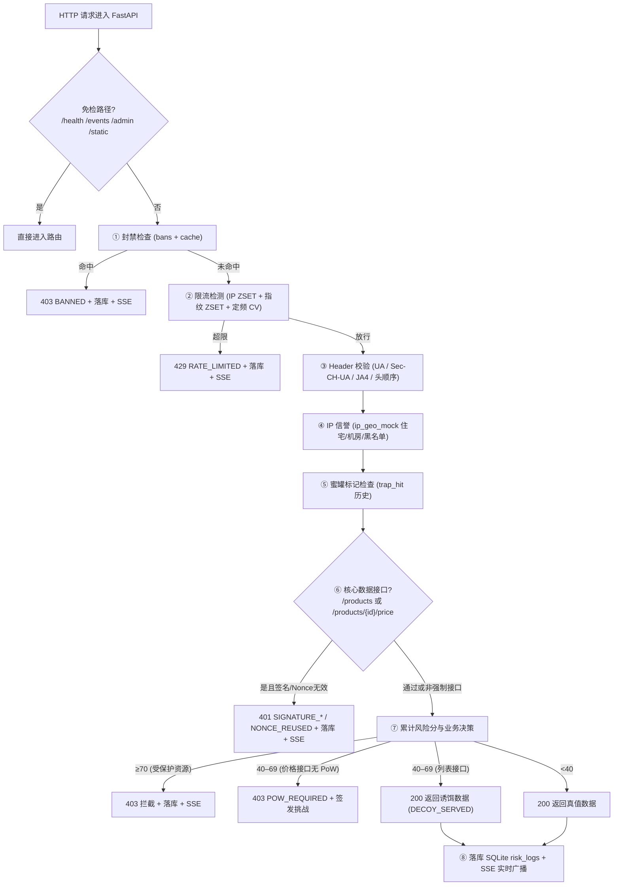

# AntiCrawl Lab（反爬实验室）靶场系统 v2.0

## 1. 项目简介与四关卡教学目标

**AntiCrawl Lab** 是一套面向网络安全研究员、风控工程师与前端/爬虫开发者的**本地隔离防御导向教学靶场**（与 DVWA / CTF 靶场同构），用于验证伪装工具、无头脚本与代理 IP 策略能否绕过现代多层反爬防线。

| 关卡 | 模块 | 教学目标 | 详细文档 |
| --- | --- | --- | --- |
| Level 1 | 网络与协议层 | 滑动窗口限流（IP & 指纹双维度）、定频 CV 识别、条件 Header 规则、Mock GeoIP 与 4 形态蜜罐矩阵 | [level1-network.md](docs/level1-network.md) |
| Level 2 | 浏览器指纹与环境 | Canvas 双渲染防噪点、WebGL 掩码/软渲染、OfflineAudio、7 维一致性矩阵、Web Worker/Math 交叉校验 | [level2-fingerprint.md](docs/level2-fingerprint.md) |
| Level 3 | 自动化与行为动力学 | `webdriver`/getter 篡改、`$cdc_`/CDP 探针、Iframe 跨 Realm、轨迹直线度、`isTrusted` 与访问顺序图 | [level3-automation.md](docs/level3-automation.md) |
| Level 4 | 防逆向与业务混淆 | HMAC 签名 + Nonce 防重放、8 变体动态字体（轮廓微扰）、Shadow DOM/Canvas/CSS 乱序、PoW 与诱饵数据 | [level4-business.md](docs/level4-business.md) |

---

## 2. 快速开始

### 方式一：`./scripts/bootstrap.sh` 一键启动（无需外部 Redis）

`REDIS_URL` 留空时，系统通过 `backend/app/cache.py` 自动降级为进程内 `fakeredis`，限流、封禁、Nonce 去重接口与行为完全一致：

```bash
# Linux / macOS / Windows Git Bash
chmod +x scripts/bootstrap.sh
./scripts/bootstrap.sh
```

Windows PowerShell 用户也可直接运行：

```powershell
.\scripts\bootstrap.ps1
```

启动后访问：
- 前端靶场与仪表盘：`http://127.0.0.1:5173`
- 后端 API 与 OpenAPI：`http://127.0.0.1:8000/docs`
- 后端 SSR 动态字体演示页：`http://127.0.0.1:8000/price`

### 方式二：`docker-compose.yml` 模式（真实 Redis）

```bash
docker compose up --build
```

### 两种模式差异说明

| 对比项 | 一键本地模式 (`bootstrap.sh`) | Docker Compose 模式 (`docker-compose.yml`) |
| --- | --- | --- |
| 缓存后端 | `fakeredis`（进程内内存模拟） | 真实 `redis:7-alpine` 实例 |
| `/api/v1/health` 返回 | `"redis_mode": "fakeredis"` | `"redis_mode": "real"` |
| 进程重启后限流/Nonce | 随进程销毁重置（SQLite 持久化表保留） | 由 Redis 容器保留至 TTL 到期 |
| 业务规则与接口契约 | 完全一致（均经 `cache.py` 门面调用） | 完全一致 |

---

## 3. 架构示意（全局风控中间件 8 步流水线）



---

## 4. 每关卡说明与 `X-Simulated-IP` 演练指南

当 `.env` 中 `LAB_MODE=1`（默认）时，所有请求可通过 `X-Simulated-IP` 请求头模拟不同地域与信誉段（同时也可直接在前端顶部导航栏下拉切换）：

| 模拟 IP 段 | 预设归属地 / ASN | 触发规则 |
| --- | --- | --- |
| `116.228.10.5` | CN / Shanghai（中国电信住宅宽带） | 正常住宅 IP（+0 分） |
| `123.125.20.8` | CN / Beijing（中国联通住宅宽带） | 正常住宅 IP（+0 分） |
| `52.95.10.20` | US / Ashburn（AWS 机房） | `DATACENTER_IP` (+25 分)；若报 `Asia/Shanghai` 再触发 `FINGERPRINT_CONFLICT` (+20 分) |
| `47.242.30.40` | HK / Hong Kong（阿里云机房） | `DATACENTER_IP` (+25 分) |
| `198.51.100.88` | US / 黑名单高危网段 | `BLACKLIST_IP` (+25 分) |

> **安全边界提示**：当 `LAB_MODE=0` 时，服务端严格忽略 `X-Simulated-IP` 并关闭全部 `/api/v1/admin/*` 未鉴权管理端点。

---

## 5. API 契约与 SSE 实时事件流概览

完整交互式文档见运行后端后的 `http://127.0.0.1:8000/docs`。核心 12 个端点：

1. `GET /api/v1/health` — 返回健康状态、`redis_mode`、`lab_mode` 与前后端单源 `rules_meta`
2. `POST /api/v1/fingerprint/report` — 全量浏览器指纹与自动化探针上报
3. `POST /api/v1/behavior/trace` — 鼠标轨迹、键盘动力学、滚动与访问顺序上报
4. `GET /api/v1/products` — 商品列表（强制签名；风险分 ≥40 返回诱饵数据）
5. `GET /api/v1/products/{id}/price` — 单品价格（强制签名 + 访问顺序图 + 40–69 转 PoW）
6. `GET /api/v1/font/session` — 下发会话动态字体二进制（`woff2`/`woff`）与 `X-Font-Seed`
7. `POST /api/v1/challenge/pow` — PoW 挑战签发（空 body）与答案核验（`{data, answer}`）
8. `GET /api/v1/trap` & `POST /api/v1/trap/form` — 蜜罐诱捕（触发即封禁 `BAN_SECONDS`）
9. `GET /api/v1/events` — 原生 `EventSource` SSE 实时风控事件流（`event: risk`）
10. `GET /api/v1/admin/requests` — 分页日志查询及 `?id=` 单条画像全量详情
11. `POST /api/v1/admin/unban` — 一键解封 `{ip}`（落审计字段 `lifted_by`）
12. `POST /api/v1/admin/reset` — 清空指定 `{ip}` 的限流计数与风控告警缓存

### 实战增强扩展端点（商业防线 + 机器人检测台）

- `GET / POST /api/v1/bot/check` — 参考 **BrowserScan / BrowserLeaks / Sannysoft** 30+ 指标输出 `bot_confidence` (0–100)、`verdict` 与归因详情（对应前端页面 `/bot-check`）
- `GET / POST /api/v1/waf/protected-feed` — 复刻边缘 WAF **200 HTML 混淆 JS 动态令牌挑战（`timestamp__1366`）**
- `GET /api/v1/browse/limit` & `POST /api/v1/browse/mock-login` / `mock-logout` — 匿名浏览深度配额与模拟登录解锁（联动 `GET /api/v1/products?page=3`）
- `GET /api/v1/time` — 服务端授时校准接口（配合响应头 `X-RateLimit-Tier / Burst-Capacity / Replenish-Rate / Remaining / X-Request-Id`）

---

## 6. 验收自测（12 条用例可复制命令）

> 以下命令假定后端运行于 `http://127.0.0.1:8000`，且 `LAB_MODE=1`。

### 运行自动化全量单测与检测回归校准矩阵
```bash
cd backend
.\.venv\Scripts\pytest.exe tests -v   # Linux/macOS 用 ./.venv/bin/pytest tests -v
```

### 运行合规自动化检测回归运行器（37 项检测矩阵 + FPR/TPR 校准报告）
> **安全边界提示**：`--mode inprocess` 完全在进程内隔离运行（零外网请求）；`--mode live` 默认仅允许指向 `127.0.0.1` / `localhost`，且会前置校验目标 `/api/v1/health` 确认其确为 `LAB_MODE=1` 的 AntiCrawl Lab 靶场，杜绝对第三方站点发包。

```bash
# 1. 进程内全隔离回归（无需启动外部服务，自动验证 FPR=0% 与 TPR=100%）
.\backend\.venv\Scripts\python.exe scripts/regression_runner.py --mode inprocess

# 2. 针对本地运行中靶场的实时回归，并导出 JSON / Markdown 报告
.\backend\.venv\Scripts\python.exe scripts/regression_runner.py --mode live --base-url http://127.0.0.1:8000 --report-md docs/regression-report.md

# 3. 如需针对自有部署的实验室实例验证，必须显式传入 --allow-own-lab
.\backend\.venv\Scripts\python.exe scripts/regression_runner.py --mode live --base-url http://127.0.0.1:8000 --playwright
```

### 手工快速复现命令
```bash
# 1. IP 频率限制（同模拟 IP 1 秒内连打 11 次，第 11 次返回 429 RATE_LIMITED）
for i in $(seq 1 11); do curl -s -o /dev/null -w "%{http_code}\n" -H "X-Simulated-IP: 116.228.55.1" http://127.0.0.1:8000/api/v1/font/session; done

# 2. Header 异常告警（空 User-Agent 请求业务接口，返回 200 且记录 HEADER_MISSING）
curl -i -H "User-Agent:" http://127.0.0.1:8000/api/v1/font/session --output /dev/null -w "HTTP %{http_code}\n"

# 3. 机房 IP 识别（X-Simulated-IP 指向美国机房段，记录 DATACENTER_IP）
curl -s -X POST -H "X-Simulated-IP: 52.95.10.20" http://127.0.0.1:8000/api/v1/challenge/pow

# 4. 蜜罐封禁与解封
curl -i -H "X-Simulated-IP: 123.125.99.9" http://127.0.0.1:8000/api/v1/trap
curl -i -H "X-Simulated-IP: 123.125.99.9" http://127.0.0.1:8000/api/v1/font/session
curl -s -X POST -H "Content-Type: application/json" -d '{"ip":"123.125.99.9"}' http://127.0.0.1:8000/api/v1/admin/unban

# 5-7. 自动化特征 / 合成事件 / 直线轨迹演示（参见前端 /probes 一键红队注入或 scripts/attack_sim.py）
python scripts/attack_sim.py

# 8. 签名缺失拦截（返回 401 SIGNATURE_MISSING）
curl -s http://127.0.0.1:8000/api/v1/products

# 9. Nonce 重放拦截（运行 scripts/attack_sim.py 中的画像 D 或在前端 /price 点「重放 Nonce」观察 401 NONCE_REUSED）

# 10. 动态字体反爬验证（源码为私用区 U+E000–U+E00A 乱码）
python -c "import requests;print(requests.get('http://127.0.0.1:8000/price').text)"

# 11. 一致性破绽（美国模拟 IP + Asia/Shanghai 时区上报指纹 -> FINGERPRINT_CONFLICT）
curl -s -X POST -H "Content-Type: application/json" -H "X-Simulated-IP: 52.95.10.20" \
  -d '{"ua":"Mozilla/5.0","platform":"Win32","languages":["zh-CN"],"timezone":"Asia/Shanghai","canvas_hash":"a1","audio_hash":"b1"}' \
  http://127.0.0.1:8000/api/v1/fingerprint/report

# 12. SSE 实时事件流观测
curl -N http://127.0.0.1:8000/api/v1/events
```

---

## 7. FAQ 常见问题排查

1. **Redis 未启动如何降级？**
   - 保持 `.env` 中 `REDIS_URL=` 为空即可自动使用进程内 `fakeredis`。即使配置了 `REDIS_URL` 但实例不可达，系统也会在日志告警后自动降级至 `fakeredis`，不影响业务跑通。
2. **端口冲突（8000 / 5173 已被占用）？**
   - 修改 `.env` 中的 `BACKEND_PORT` 与 `FRONTEND_PORT`；`vite.config.ts` 支持 `VITE_BACKEND_URL` 环境变量同步代理目标。
3. **动态字体页面依然显示方框或乱码？**
   - 打开浏览器开发者工具检查 `/api/v1/font/session` 响应头是否包含 `X-Font-Seed`；确认未启用屏蔽自定义 Web 字体（`@font-face` / `FontFace`）的隐私浏览器扩展；检查 `backend/static/fonts/` 下是否已通过 `python scripts/make_font.py` 生成 8 个 `.woff2`/`.woff` 文件及 `variants.json`。
4. **SSE 实时事件流无输出或延迟？**
   - 确认请求经过 Vite 代理或直连后端时未经过开启 `proxy_buffering on` 的反向代理；后端已配置 `X-Accel-Buffering: no` 与即时心跳注释；若 `LAB_MODE=0`，管理历史查询已关闭但事件触发仍需先访问业务接口。

---

## 8. 使用边界声明

> 本靶场仅供安全研究与教学使用：默认仅监听 127.0.0.1，请部署于本地或隔离环境；如需公网访问，必须先为仪表盘与管理端点增加鉴权；不得将本系统的任何探针、蜜罐或封禁规则指向第三方站点；蜜罐、模拟 IP 等实验室规则未经安全与法务评估不得移植到生产环境。

---

## 9. 数据隐私声明

> 采集的指纹与行为数据仅存于本地 SQLite，默认 7 天滚动清理，不上传、不外发、不用于教学之外的任何用途。
